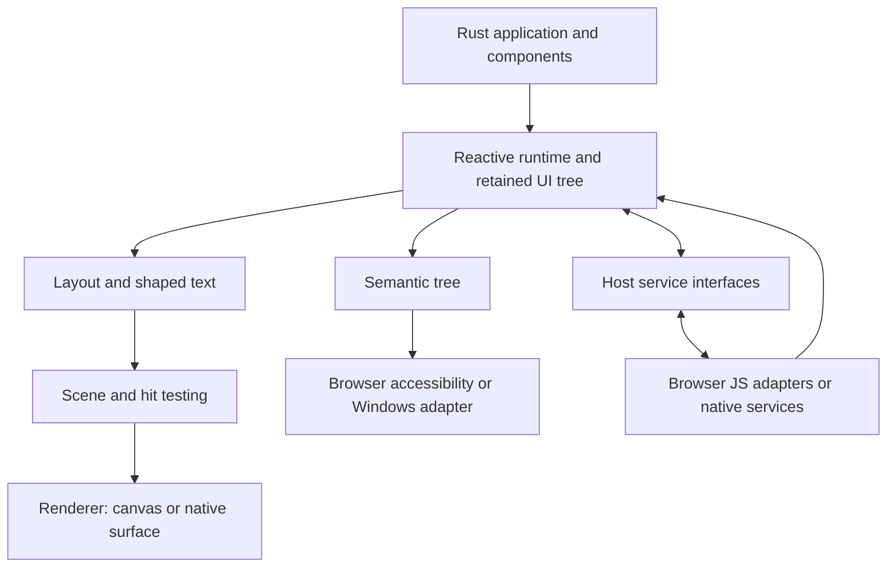

# RustX — Framework Specification and Build Blueprint

**Specification:** 1.1 · **Implementation update:** 1 November 2026 · **Prepared:** 30 October 2026  
**Working name:** RustX · **Authoring language:** Rust · **UI syntax:** `rustx! { ... }`  
**Targets:** browser WebAssembly first; shared native Windows x64 application second  
**Document status:** implementation contract with Stage 1 foundation source delivered; platform acceptance remains open.

## 0. Current source and continuation — 1 November 2026

`RustX_Stage_01.zip` is the complete Stage 1 foundation source, with a prebuilt browser bundle when the build passes. It does not depend on an earlier ZIP. Application code is `examples/lab/src/app.rustx`, ordinary Rust loaded with `#[path]` and markup inside `rustx!`. There is no separate Rust compiler fork.

Delivered: typed component macro, scoped signals/memo/effects/cleanup/context/refs, keyed identity, Rust layout/shaping/scene, CPU and GPU adapters, JS GET/cancel capability bridge, native host, fixture server, build scripts, tests and handoff documents. The app contains a responsive homepage, interactive precompiled playground presets, People Explorer with local/JSONPlaceholder actions, and a keyed counter/Persian input lab.

**Stage 1 is not fully accepted.** Tests of core behavior and actual Wasm execution are recorded in `docs/ACCEPTANCE.md` with logs for this snapshot. Missing real browser, physical GPU, Windows, screen-reader and IME evidence remains unverified/blocked. No speed comparison against React or Go is claimed. Engine PNGs and software graphics probes do not certify browser or device behavior.

**Next agent:** read `AGENTS.md`, `docs/STATUS.md`, `docs/ACCEPTANCE.md`, `docs/COMPATIBILITY.md`, and `docs/NEXT_AGENT.md`. Replay tests against the supplied source; then close the browser/native rendering and semantic/input feasibility gates. Do not restart the framework or inherit old RustUI readiness percentages. The earliest unmet gate remains Stage 1, not Stage 2.

RX-01 is implemented but needs independent fresh-machine replay. RX-02–05 are verified for their core contracts by the delivered passing tests. The actual Wasm and real local HTTP → JS Fetch → Wasm integration suites also pass; evidence is in the ZIP. RX-06 is partial GET/cancel without full capability/version negotiation. RX-07–09 still need platform acceptance. Later-stage scaffolding is not a completed requirement. The repository ledger provides all 46 row statuses.

**New final-release requirements requested by the user:** RX-45 is a polished successful API showcase; RX-46 is a RustX homepage with a real editable Rust compile/run playground. The current preset switcher is explicitly an early demonstration, not completion of RX-46. See Section 13.2.1 for their finish line.

## 1. The product and its finish line

RustX is a Rust-authored, declarative UI framework for building interactive applications. Developers import typed components such as `<Button>`, compose them with JSX-like markup, express behavior in Rust, and compile their application into WebAssembly. Rust owns application state, component identity, layout, text shaping, hit testing, and the visual scene. A renderer draws that scene into a browser canvas. A small browser host provides networking and other browser capabilities.

The same application and engine must also compile to native Windows machine code, presented in a native window without an embedded browser. This preserves the previous RustUI project's browser/Windows direction. The browser experience is the primary design and delivery priority.

**RustX v1 is complete when a developer unfamiliar with the implementation can install its CLI, create a project, build the reference applications, run them in the supported browsers and Windows, and pass every required acceptance gate in this document.** A working counter, a GPU screenshot, or a successful cross-compile alone does not satisfy this definition.

There are exactly four delivery stages. Each contains multiple engineering tasks. No duration estimate or percentage implies that a stage has passed. The final checklist is finite; additional ideas belong in a later roadmap.

### 1.1 Relationship to earlier work

The earlier `rust-ui-framework-blueprint.md` used the placeholder RustUI and recorded partial Step 1/2 verification. This is a new RustX specification, not a retroactive certification of those artifacts. If that code is supplied, audit it against this contract, reuse verified modules, and record compatibility gaps. Do not import its old readiness percentages or silently discard working code. This document takes precedence for the new RustX implementation where the two specifications differ.

### 1.2 What removing HTML means in this release

| Area | RustX v1 contract |
| --- | --- |
| Application authoring | Rust and typed UI styles; no hand-authored HTML, CSS, or JavaScript required for normal applications |
| Visible application layout | Computed in Rust, not delegated to browser DOM layout |
| Visible controls | Drawn into canvas by the Rust-owned rendering pipeline |
| Browser boot | Generated HTML shell, canvas, JavaScript loader, and browser adapters remain necessary |
| Browser accessibility | A synchronized semantic DOM projection is required; canvas pixels do not expose a usable control tree by themselves |
| Text input | A browser input/textarea adapter handles IME and platform input integration; Rust owns the application text model and visible editing UI |
| Native Windows | Shared Rust application and engine; platform-specific window, input, accessibility, and service adapters |
| Future HTML-free platform | A separate runtime/host project that may reuse RustX; not delivered by this framework alone |

The browser release is **canvas-rendered, with no DOM-based visual component layout**. It is not literally a zero-DOM browser application. The accessibility/input bridge is an explicit architectural requirement, not an accidental exception. [S1, S9]

WebAssembly does not provide ambient browser networking primitives. A Rust function can nevertheless invoke browser networking through imported host functions, including generated bindings. JavaScript calls the browser Fetch/WebSocket APIs; the browser performs the networking. The developer still writes Rust. The same boundary applies to graphics, clipboard, storage, navigation, timers, and input—not only HTTP. [S1, S8]

This release downloads and executes application Wasm. It does not meet a future requirement that websites execute no downloaded application code. That different model needs a pretrusted runtime interpreting restricted declarative data or a remote application protocol; reserve it for a separate specification.

## 2. Choose Rust, with measurable reasons

**Decision: use Rust, not Go, for RustX's core and application language.** This is an architecture recommendation, not a claim that every Rust program outperforms every Go or JavaScript program.

| Criterion | Rust | Go | Decision impact |
| --- | --- | --- | --- |
| Memory behavior | Ownership and explicit resource lifetimes; no mandatory tracing garbage collector | Standard toolchain includes a runtime and garbage collector | Rust gives more control over allocation and resource lifetimes in rendering paths |
| Browser compilation | Established Wasm bindings and native compilation | Official browser Wasm support with JavaScript integration | Both can work; Wasm support alone does not decide performance |
| Rendering ecosystem | Taffy, cosmic-text, wgpu, Vello, winit, AccessKit | Would require a different integration plan | Reuse the Rust ecosystem for this architecture |
| JSX-like authoring | Procedural macros extend Rust syntax inside a macro | Go would need an external syntax frontend or another authoring approach | Rust provides a practical first implementation without forking its compiler |
| Learning cost | Ownership, borrowing, lifetimes, async, and compile-time diagnostics require care | Generally simpler application-level learning curve | Hide engine ownership complexity behind safe scoped APIs; do not pretend Rust is JavaScript |
| Speed and download size | Must be measured for the complete application | Must be measured for the complete application | No advertised multiplier until comparable benchmark evidence exists |

The language/runtime facts above are grounded in official Rust and Go documentation. The choice of Rust for this particular project is an engineering judgment. [S2, S3, S4]

Rust removes neither layout work nor text shaping, GPU uploads, startup costs, input latency, or accessibility work. A poorly designed Rust canvas framework can be slower and less usable than a well-built DOM application.

## 3. Source format and developer experience

### 3.1 One language, two file extensions

1. Implement ordinary `.rs` files containing `rustx!` first. Use stable Rust and Cargo.
2. Support `.rustx` files containing the **same valid Rust module syntax**, including `rustx!`. Register them with explicit module paths or the RustX project tooling. An initial entry can use `#[path = "app.rustx"] mod app;`.
3. Do not fork rustc. The `.rustx` extension does not itself make bare `<Button>` expressions valid Rust. Markup lives inside `rustx!` in v1.
4. First-class `.rustx` formatting, navigation, completion, and diagnostics are mandatory before v1. A file that builds but is unusable in an editor is only an intermediate milestone.
5. Bare JSX-style expressions outside a macro are a future language frontend. They are not necessary to ship RustX v1.

Procedural macros are the syntax extension mechanism. Use a real parser, preserve spans, and lower markup to normal Rust builder/runtime calls. Do not parse nested Rust expressions with regex or modify the upstream Rust grammar. [S4]

### 3.2 Proposed authoring example

**Design target only:** the following API is to be implemented and validated. It is not an existing crate API or executable artifact supplied with this document.

```rust
use rustx::prelude::*;
use rustx::widgets::{Button, Column, Text};

#[component]
fn Counter(cx: Scope, initial: i32) -> View {
    let count = cx.signal(initial);
    let label_count = count.clone();
    let action_count = count.clone();

    rustx! {
        <Column style={style::column().gap(12.0).padding(24.0)}>
            <Text>{"Hello from RustX"}</Text>
            <Text>{move || format!("Count: {}", label_count.get())}</Text>
            <Button on_click={move |_| {
                action_count.update(|value| *value += 1);
            }}>
                <Text>{"Increase"}</Text>
            </Button>
        </Column>
    }
}
```

Canonical event properties use Rust `snake_case`. A finite documented alias table may accept JSX-style spellings such as `onClick`; the parser normalizes aliases and rejects duplicate canonical/alias pairs. The canonical names drive diagnostics and generated documentation.

### 3.3 Authoring contract

| Feature | Required behavior |
| --- | --- |
| Imports | Uppercase tags resolve to Rust components imported through ordinary `use`; custom components can be distributed as crates |
| Typed props | Required/optional/default props, enums, callbacks, generic props, and children are checked by Rust |
| Markup | Paired/self-closing tags, fragments, nested components, Rust expressions, comments, and escaped text |
| Text | String literals and explicit dynamic bindings; no implicit JavaScript coercion |
| Dynamic children | Conditional views and keyed collections with documented identity rules |
| Slots | Default children and typed named slots; slot ownership and evaluation rules documented |
| References | Scoped node/component handles; no browser `Element` types in portable application APIs |
| Styles | Typed Rust style values and theme tokens; no dependency on CSS selector evaluation |
| Errors | Unknown tags/props, missing required props, invalid types, malformed nesting, and duplicate props point to user source |
| Escape hatch | A typed custom drawing component and explicit host-specific service extensions |

### 3.4 What “all React JSX tags” means

JSX is syntax; `<Button>` is usually an imported component, not a built-in React control. RustX supports the same composition idea, but a React/MUI component written in JavaScript cannot be imported into a Rust canvas tree unchanged.

Define a **finite compatibility manifest** rather than promising all HTML, SVG, DOM APIs, and React behavior:

| Familiar construct | RustX equivalent | v1 boundary |
| --- | --- | --- |
| `<div>`, `<span>`, headings, paragraphs | `Box`, `Text`, `Heading`, `Paragraph` and documented lowercase aliases | Typed layout/text with explicit semantics; no browser CSS cascade |
| `<button>`, `<input>`, `<textarea>` | `Button`, `TextInput`, `TextArea` | Supported controls with real interaction/accessibility contracts |
| `<a>`, ``, form/label | `Link`, `Image`, `Form`, `Label` | Navigation/alternative text/form association are implemented explicitly |
| Lists/tables | `List`, `VirtualList`, `Table` | Documented table sizing subset; no full HTML table algorithm promise |
| Custom JSX components | Rust function components and crates | Source rewrite required when migrating React libraries |
| Fragments, context, refs | RustX fragments, scoped context, scoped refs | Similar purposes, separately specified semantics |
| Portals/dialog layers | Overlay root within the retained scene | No arbitrary DOM portal target |
| SVG/path elements | Typed vector primitives and a documented SVG asset subset | Not the complete SVG DOM, filters, scripting, or animation standard |
| `iframe`, arbitrary HTML, scripts, embedded web pages | Explicit unsupported feature | Cannot silently create browser-rendered visual content |
| Video/audio | Future host extension | Full media widgets and DRM excluded from v1 |
| React hooks, Suspense, concurrent rendering, hydration | RustX-specific reactive/async facilities | No drop-in compatibility claim |

Every alias must declare its props, semantics, events, target support, and test. Unsupported tags fail clearly; they never appear to work while doing nothing.

## 4. Architecture and ownership

### 4.1 Compile-time and runtime separation

The build tool resolves RustX modules, the macro parser lowers markup into typed Rust, and rustc compiles the application with the framework. Browser packaging then generates Wasm bindings, the host loader, the HTML shell, and hashed assets. Native packaging links the same application to the Windows host.

At runtime, keep these responsibilities distinct:



### 4.2 Logical modules and dependency direction

Start with a small workspace; use modules where separate crates add no value. The following boundaries must remain visible even when several live in one crate.

| Boundary | Owns | Must not own |
| --- | --- | --- |
| `rustx` | Public facade and prelude | Browser-specific implementation types |
| `rustx-macros` | Markup parsing, component expansion, diagnostics | Runtime state or rendering |
| `rustx-core` | Node identity, component scopes, signals, scheduling, events, semantics | DOM, JS values, winit handles, concrete HTTP clients |
| `rustx-style-layout` | Typed styles, theme resolution, Taffy integration, text measurement contract | Browser layout or network fetching |
| `rustx-text` | Fonts, shaping, editing model, selection/index conversion | DOM input ownership |
| `rustx-scene` | Geometry, paint order, clips, display items, hit-test data | App business logic |
| `rustx-render-*` | GPU/software backends and resource caches | Component lifetime policy |
| `rustx-host-api` | Typed service requests/results and capability reports | Concrete platform APIs |
| `rustx-web` | Browser bootstrap, JS adapters, canvas, input and semantics projection | App-specific screens or reducers |
| `rustx-native` | Windows window, native services, UI Automation integration | Browser assumptions |
| `rustx-widgets` | Accessible reusable controls and interaction behavior | Private access to app state |
| `rustx-cli` | Scaffold, dev, build, check, format, package, diagnostics | A second application runtime |

Core depends on abstractions; host/rendering adapters depend on core contracts. Widgets depend on public runtime/layout contracts. Use trait-based dependency injection at service boundaries, with fake hosts for tests. Do not introduce generic repository layers, a service locator, or enterprise abstractions without a concrete framework need.

### 4.3 Trees are different data models

Maintain explicit identities and mappings between the component tree, reactive dependency graph, retained layout/UI tree, flattened display scene, and semantic tree. They do not have a one-to-one node count. A component can render many visual nodes, and decorative nodes may have no accessibility representation.

Use generational IDs for components, nodes, tasks, and resources. Never expose long-lived raw pointers to JavaScript. Ownership must specify who drops every event callback, subscription, font/image, GPU allocation, and host operation.

## 5. Runtime semantics: decide these before adding widgets

### 5.1 Reactive model

**Decision: mount-once component setup with fine-grained reactive bindings and a retained tree.** Do not combine it accidentally with React's re-executed function/hook model.

- A component setup function runs when that instance mounts. Its scope owns signals, effects, refs, and tasks.
- A plain Rust expression is evaluated when its surrounding construction executes. A dynamic closure/binding is evaluated reactively and tracks signal reads.
- Reactive props are explicit readable values/bindings. Changing a parent's bound prop updates the child binding without rerunning child setup. Plain props are initial immutable configuration; changing them requires an explicit keyed remount or a reactive prop.
- `signal` stores values; `memo` computes derived values; `effect` performs post-commit work. Effects provide cleanup before rerun and on disposal.
- Computed bindings must be pure. Effects may schedule state changes, but cycles and unbounded update loops trigger diagnostics with a bounded iteration guard.
- Batches coalesce notifications. Derived values become consistent before layout and commit. No partially applied tree is exposed to input dispatch.
- UI state is single-thread owned. Background jobs send typed messages to the owner; `Send`/`Sync` requirements are explicit.
- Signal handles are safe scoped handles. Use-after-disposal returns a defined error/no-op outcome with development diagnostics, never accesses freed memory. Retained handles must not accidentally keep a whole unmounted tree alive.

### 5.2 Identity and disposal

- Stable keyed siblings preserve state, focus, selection, refs, and active resources during reorder.
- Component identity combines parent scope, component type, and key/position. A different component type at a reused key remounts.
- Duplicate sibling keys are a deterministic development error. Index keys are documented as unsuitable for mutable/reordered collections.
- Conditional branches dispose removed scopes. Reappearing branches mount afresh unless an explicit keep-alive feature is added later.
- Refs attach after commit and clear before disposal completes.
- Unmount cancels tasks, unsubscribes effects, releases pointer capture/focus safely, removes semantic nodes, and drops resources.
- Typed recoverable errors can render error views. A fatal Wasm trap/panic triggers a host-level fatal state/restart path; do not promise React-style panic recovery inside a broken Wasm instance.

### 5.3 Scheduling and frame pipeline

For a visual frame: process bounded input/results → apply state batch → update affected bindings → measure/layout dirty subtrees → build scene and semantic deltas → commit atomically → paint → run post-commit effects.

Use `requestAnimationFrame` for browser visual work. Async service completion must not depend on frames while a tab is hidden; process bounded state/service queues independently and defer painting. Idle applications do not run an unconditional render loop. Pause animations appropriately when backgrounded.

Distinguish layout dirtiness, paint dirtiness, and semantic dirtiness. A color change should not reshape unrelated text or reflow the application. Cache keys include all values that affect the result. Correctness comes before partial redraw: start with retained full-frame composition and measured caching, then add damage tracking only with equivalence tests.

## 6. Layout, text, and rendering

### 6.1 Layout and styling

Use Taffy behind the layout interface for its supported block/flex/grid algorithms. RustX must still implement style resolution, measurement callbacks, responsiveness, scroll state, and invalidation. Taffy is not a complete CSS engine. [S5]

Required v1 styles: logical/physical spacing, gap, px-like logical units, percentages, auto, min/max constraints, flex and grid, alignment, absolute positioning, overflow/clipping, borders/radii, fills/gradients, opacity, transforms, bounded shadows, stacking order, and typography. Provide light/dark themes, token inheritance, hover/focus/disabled/invalid states, viewport breakpoints, and reduced-motion settings. Document unsupported combinations and percentage-resolution rules.

Use logical pixels throughout layout and input. Convert to backing-store pixels at the renderer boundary. Handle DPI/browser zoom changes, resize, zero-size surfaces, orientation changes, and mobile visual viewport/keyboard changes without stale hit-test geometry.

### 6.2 Text is a first-class subsystem

Use cosmic-text as the initial shaping/layout/editing foundation, behind an adapter. Its support for bidirectional text and font fallback is relevant, but browser font discovery and complete editing integration remain RustX work. [S6]

Required behavior:

- Persian/Arabic shaping, English, mixed RTL/LTR text, combining marks, ligatures, emoji, fallback fonts, multiline wrapping, alignment, ellipsis, and explicit language/direction.
- Licensed bundled fonts for reproducible output; no assumption that browser Wasm can enumerate installed system fonts. Font readiness invalidates shaping and dependent layout once.
- One measured glyph layout drives drawing, caret placement, selection, and hit testing. Do not measure with browser text and draw different Rust-shaped glyphs.
- Specify byte offsets, Unicode scalar positions, grapheme boundaries, UTF-16 DOM offsets, and visual caret positions. Convert explicitly at the browser input boundary.
- Selection/copy for ordinary text, not just editable fields; keyboard selection, word/line movement, grapheme-aware deletion, undo/redo, and composition-aware editing.
- Cache shaping by text, font selection, size, available width, direction, language, and relevant features; evict under a bounded memory policy.

### 6.3 Renderer selection

Use a backend-independent scene and renderer interface. The default direction is **wgpu plus a proven Vello-family GPU backend**, with a CPU renderer as the required compatibility path. Evaluate and pin compatible releases at Stage 1; do not blindly reuse earlier RustUI dependency versions.

As checked on the preparation date, Vello documents CPU, raster GPU, and compute-centric implementations with different maturity/hardware requirements. Its original compute renderer is not interchangeable with a WebGL2 renderer. wgpu's WebGL2 support alone does not prove that a particular renderer works on WebGL2. [S7, S10]

| Path | Requirement |
| --- | --- |
| Preferred | Selected GPU backend renders directly to browser canvas/native surface on supported hardware |
| Optional acceleration fallback | WebGL2 only after the selected renderer passes the same visual/interaction suite |
| Mandatory compatibility | CPU rasterization in Rust, with browser host presenting pixels; reduced performance is documented and measured |
| Failure | Accessible diagnostic if even the compatibility path cannot initialize; never a blank canvas |

Stage 1 must prove a shared test scene containing shaped text, image, transform, rounded clip, and transparent overlap on the GPU and CPU paths. If the preferred dependency cannot pass, isolate the failure and choose a renderer replacement through an architecture decision record. Do not replace the entire language/runtime to fix one adapter.

Required scene features: rectangles, rounded rectangles, paths, fill/stroke, images, glyph runs, transforms, nested clipping, opacity groups, predictable z-order, gradients, and bounded shadow/filter behavior. Normalize alpha/color handling; compare backends with a declared image tolerance. Support device loss, surface recreation, and resource reupload.

The normal GPU path must not render to a texture, read the entire frame back to the CPU, and upload it to Canvas 2D every frame. Readback is for tests/exports. Software pixel transfer is permitted only on the explicit CPU fallback.

### 6.4 Scale and drawing surfaces

Provide viewport culling, bounded image/glyph caches, resource batching, and virtualized lists. A large list must not create one million controls/semantic DOM nodes just because the data contains one million records. Preserve active/focused item semantics as windows change, and expose total counts/positions correctly.

Provide `Canvas`/`DrawingSurface` with custom display-list submission, camera pan/zoom, transforms, clip-aware hit testing, and stable world coordinates. Use camera-relative positions or another documented large-coordinate precision strategy. “Infinite canvas” means a navigable finite scene with culling, not infinite memory.

## 7. Input, controls, and accessibility

### 7.1 Event contract

Normalize browser/native input into typed Rust events: pointer down/move/up/cancel/enter/leave, wheel/scroll, key down/up, focus/blur, text input/before-input/composition, click/activation, clipboard, file drop, resize, and resource errors.

Specify capture → target → bubble dispatch against a committed tree; transformed coordinates; clip-aware hit testing; pointer capture and cancellation; focus order; disabled/read-only behavior; touch scrolling and gestures; and keyboard activation. Default actions must be cancellable synchronously where the browser allows it. An asynchronous callback cannot retroactively prevent a browser action. Privileged gesture-bound operations must retain a valid user-activation path.

Prevent duplicate activation when a semantic DOM control and a canvas pointer path represent the same button. Preserve keyboard shortcuts reserved by the browser/OS unless the user is interacting with a component that appropriately handles them.

### 7.2 Required component library

| Group | v1 components |
| --- | --- |
| Layout/content | Box, Row, Column, Grid, Stack, Spacer, Divider, ScrollView, Text, Heading, Paragraph, Image, Icon |
| Actions/navigation | Button, IconButton, Link, Tabs, Menu, MenuItem, Breadcrumbs |
| Forms | Form, Label, TextInput, PasswordInput, TextArea, Checkbox, RadioGroup, Switch, Select, Combobox, Slider |
| Feedback/overlays | Dialog, Popover, Tooltip, Alert, Toast, Progress, Spinner |
| Collections | List, VirtualList, Table with selectable/sortable rows |
| Graphics | Canvas/DrawingSurface and basic vector primitives |

Each interactive control needs typed props, documented events, keyboard behavior, semantic role/name/value, focus states, disabled state, theme support, RTL behavior, and tests. Do not call a painted rectangle with a click handler a complete Button.

Forms require controlled values, dirty/touched tracking, field-level and form-level validation, async validation with stale-result protection, submission state, reset, and accessible error associations. Where uncontrolled initialization is offered, changing controlledness at runtime produces a diagnostic. Date pickers, full spreadsheets, rich text editors, and specialized chart libraries are extension work after v1.

### 7.3 Browser input integration

Use a focusable input/textarea bridge positioned/sized to support input and composition; do not use `display:none` and assume mobile keyboards or IME will work. Synchronize value, selection, input type, language, direction, and caret/composition positioning. Bridge `beforeinput`, `input`, composition, paste, cut, and selection updates while preventing feedback loops. Test real IME behavior; draft Input Events specifications do not guarantee uniform implementation. [S11]

Only one accessible editing representation may be active for a field. Coordinate the input bridge and semantic tree to avoid duplicate announcements or focus. Password values must be excluded from logs, devtools dumps, and semantic diagnostics. Autofill/password-manager integration gets an explicit tested support matrix; it is not automatically equivalent to native HTML forms.

### 7.4 Semantic projection and platform integration

The semantic tree carries roles, names, descriptions, values, state, relationships, headings/landmarks, focus, selection, and supported actions. It updates from the same committed model as the canvas scene.

The browser host maps semantics to accessible DOM/ARIA. Windows maps semantics to UI Automation through a verified adapter, with AccessKit as the initial choice. Do not assume a library's native accessibility adapter also solves its browser projection. [S9, S12, S13]

Browser semantic nodes must remain exposed to assistive technology; `aria-hidden`, `display:none`, or `visibility:hidden` cannot hide the active accessibility representation. Define projection positioning and hit-test/focus behavior explicitly. Browser DOM layout must never determine the visible app's geometry. Test screen-reader navigation as well as keyboard tab navigation, including modal focus trapping/restoration and offscreen virtual items.

Required manual checks: NVDA with a supported Windows browser, VoiceOver with Safari on macOS, and NVDA with the native Windows demo. Mobile baseline additionally requires real-device virtual keyboard, touch input, and a screen-reader form task on the declared mobile platforms.

Canvas does not automatically preserve browser Find, selection, translation, printing, SEO, link previews, or extension integration. Provide app-level search, text selection/copy, a printable semantic export for the reference demo, and document remaining differences. Public SEO-centric document sites and complete browser-native behavior parity are outside v1.

## 8. Browser host and networking

### 8.1 Public service interfaces

Application code receives scoped capabilities through typed interfaces, not arbitrary `JsValue` handles. Interfaces cover HTTP, WebSocket, scheduling, navigation/history, local persistence, asset loading, clipboard, file selection/download, and diagnostics. Each adapter reports supported, unavailable, denied, and failed states distinctly.

Proposed application-level networking code:

```rust
// API design target, not a currently available implementation.
async fn load_users(http: &HttpClient) -> Result<Vec<User>, HttpError> {
    http.get("/api/users")
        .timeout(Duration::from_secs(10))
        .send()
        .await?
        .error_for_status()?
        .json::<Vec<User>>()
        .await
}
```

The runtime launches this future in an owned task scope. In browsers, `send()` calls a host import; the JS adapter invokes Fetch and resolves a bounded result back into Rust. Native builds use a native HTTP adapter. Browser application developers write neither the Fetch call nor binding glue. [S8, S14]

### 8.2 HTTP contract

Required: standard methods, headers permitted by the browser, URL resolution, JSON/text/bytes, multipart upload, bounded streaming downloads, timeout, abort, credentials policy, structured errors, response limits, and progress where genuinely measurable. Fetch does not provide uniform upload-progress events; do not expose fabricated progress.

Separate transport failure, cancellation, timeout, decode failure, size-limit failure, and HTTP status errors. Non-2xx status is a response until the API applies an explicit status policy. Browser restrictions may make CORS and other network failures indistinguishable; preserve that uncertainty.

Respect same-origin/CORS rules, cookies, redirects, CSP `connect-src`, mixed-content rules, and browser permission checks. Client code contains no secrets. Use safe credential defaults and redact authorization/cookies/body contents in diagnostics. Native HTTP must not silently claim browser security equivalence. [S14]

Each request gets an ID, scope generation, and cancellation token. Cancel on unmount or superseding work; dropping a Rust future must notify the host to abort where possible. Late completion is ignored by generation checks. A slow result for query A cannot overwrite a later result for query B.

Retries are opt-in, bounded, and aware of method idempotence; mutations must not be replayed automatically. Define backpressure for streams, maximum queued bytes/messages, and resource disposal for WebSockets. Expose WebSocket ready/error/close states; reconnect is explicit policy.

Provide a small resource/query layer: typed loading/success/error state, key-based request deduplication, cache invalidation, mutation status, and documented stale-time behavior. This is a bounded framework utility, not a promise of every TanStack Query feature.

### 8.3 Boundary mechanics

- Use wasm-bindgen and generated JS bindings initially; avoid inventing a binary ABI before measurements require it.
- Batch high-frequency scene/event data; do not serialize a whole UI tree through JSON each frame.
- Structured service metadata can use Serde-compatible encoding. Large byte buffers use explicit bounded transfer/copy rules.
- JS typed-array views into Wasm memory must be refreshed after memory growth. Define ownership and validity across async calls; never retain borrowed Rust memory unsafely.
- Version internal host messages. Include request IDs and typed errors. Keep callbacks registered only while owned.
- Browser host JS may be authored in TypeScript for maintainability and compiled to JavaScript; application users still write Rust.
- Rust ownership of UI does not mean zero JS graphics calls. Generated bindings can carry GPU/Web API calls while Rust chooses geometry, text, and scene contents.

### 8.4 Routing, persistence, files, and assets

Provide typed routes, parameters/query strings, back/forward, deep links, not-found views, and navigation cancellation where supported. Browser hosting documents SPA rewrites and offers hash routing when rewrites are unavailable.

Use browser storage through async adapters, preferably IndexedDB for structured state. Expose quota/denial/errors and versioned migrations. Persistence across devices requires an application backend, not framework magic.

File operations require explicit user selection and browser permission; downloads have named MIME types. Asset loading supports hashed manifests, font/image limits, decode errors, cache invalidation, and cleanup. Native and browser assets share logical IDs, not absolute platform paths.

## 9. Security and trust boundaries

The baseline trust model is a developer-controlled application and its dependencies. Browser sandboxing limits Wasm's environmental access, but Rust memory safety is not a sandbox for untrusted code compiled into the same module.

Host capability declarations improve API discipline. They do not create strong isolation from malicious application dependencies that can import browser APIs or run build scripts. Strong capability security requires a separately instantiated untrusted module, validated imports, a policy-enforcing host, and possibly a different runtime; that is future platform work.

For v1: avoid `eval` and dynamic script construction; document CSP requirements; bound file/image/font/message/response sizes; reject malformed inputs safely; constrain parser recursion; audit `unsafe` at boundaries; redact secrets; and keep development tooling disabled in production by default. Build-time procedural macros and build scripts execute with developer privileges and need dependency trust. [S4]

Remote layouts, plugins, custom shaders, and runtime-loaded executable modules are excluded unless introduced by a separate threat model and versioned design. No arbitrary code execution feature is needed to meet this specification.

## 10. Technology and tools

These are starting choices and integration responsibilities, not an untested exact-version lockfile.

| Concern | Starting choice | Required validation |
| --- | --- | --- |
| Language/build | Stable Rust, Cargo workspace, wasm32-unknown-unknown | Pin toolchain/MSRV; commit lockfile and exact build instructions |
| Syntax | proc_macro2, syn, quote, Rust procedural macros | Parse real Rust expressions, preserve diagnostics, compile-pass/fail fixtures |
| Layout | Taffy | Text measurement, dirty propagation, supported style matrix |
| Text | cosmic-text with licensed bundled fonts | Browser build, Persian shaping, bidi selection, input offsets |
| GPU | wgpu with selected Vello GPU adapter | Direct canvas/native presentation, dependency compatibility, device recovery |
| CPU fallback | Vello CPU or a documented equivalent behind the same renderer interface | Browser/native output and full functional conformance; performance measured separately |
| Browser integration | wasm-bindgen, web-sys/js-sys where useful, futures integration | Current maintained packages; matching crate/CLI versions |
| Native window | winit | Real Windows DPI, input/IME, lifecycle and packaging tests |
| Native semantics | AccessKit adapter | UI Automation actions and screen-reader verification |
| Data/errors | serde, typed error enums, tracing | Stable public errors, correlation IDs, no sensitive payload dumps |
| Tests | cargo test, trybuild, proptest; targeted fuzzing | Core invariants, syntax failures, malformed inputs |
| Browser automation | Playwright and wasm-bindgen-test where appropriate | Chromium/Firefox/WebKit automation plus real browser/device checks |
| Performance | Criterion, browser tracing, renderer counters | Reproducible scenes and raw result artifacts |
| Supply chain | cargo audit/deny or equivalent, license inventory/SBOM | Verified licenses and vulnerability handling |
| Formatting/editor | rustfmt for ordinary Rust; RustX formatter/editor integration for macro bodies and `.rustx` | Formatting idempotence and original-file diagnostics |

Use Rust CLI/xtask commands and shell scripts where needed. Python must not be a project build/runtime dependency. Browser automation may need a pinned JavaScript tooling runtime; document it separately from the RustX application's runtime. Do not require Docker for normal development.

Pin the compatible dependency set only after the Stage 1 spike. Record selected releases, features, licenses, supported targets, rationale, and any patches in `docs/DEPENDENCIES.md`. No unpinned Git main dependencies in releases.

## 11. Required feature register

All rows below are **required for v1**, except explicitly labeled optional extensions elsewhere. Completion requires implementation, tests, documentation, and evidence on the declared targets. Current implementation status is in Section 0 and the repository acceptance ledger. Reused code is verified only after its checks pass on the delivered snapshot.

| ID | Requirement | Acceptance evidence | Stage |
| --- | --- | --- | --- |
| RX-01 | Reproducible workspace/toolchain | Clean locked build and dependency record | 1 |
| RX-02 | JSX-like macro and typed components | Positive/negative compiler fixtures | 1 |
| RX-03 | Imports, props, children, fragments, slots | External example crate compiles and runs | 1 |
| RX-04 | Scope-owned signals, memo, effects, cleanup | Dependency/disposal/event-order tests | 1 |
| RX-05 | Keys, conditionals, stable identity | Reorder preserves state; removal frees scope | 1 |
| RX-06 | Typed host services and safe IDs | Fake-host contract tests and stale-ID rejection | 1 |
| RX-07 | Browser and native skeletons | Same counter runs in browser and real Windows | 1 |
| RX-08 | Renderer/text feasibility | Shared scene passes GPU/CPU web/native spike | 1 |
| RX-09 | Semantic/input feasibility | Labeled button and editable field usable through browser bridge | 1 |
| RX-10 | Typed styles, themes, responsiveness | Layout fixtures and theme/viewport demo | 2 |
| RX-11 | Flex/grid, measurement, dirty propagation | Layout snapshots, text reflow, bounded invalidation | 2 |
| RX-12 | Unicode, RTL/LTR, fonts | Persian/English/emoji shaping and fallback fixtures | 2 |
| RX-13 | Scene, clips, transforms, paint order | Backend screenshot comparison | 2 |
| RX-14 | GPU direct presentation | Browser trace proves no normal-path frame readback | 2 |
| RX-15 | CPU compatibility and failure recovery | Forced fallback, device loss and resize checks | 2 |
| RX-16 | Caches, culling, virtual list | Large dataset with bounded materialized nodes/resources | 2 |
| RX-17 | Drawing surface and camera | Pan/zoom, hit tests, large-coordinate checks | 2 |
| RX-18 | Frame scheduling and DPI | Idle, background, resize and scaling checks | 2 |
| RX-19 | Typed event dispatch/default actions | Capture/bubble/cancel/capture-release tests | 3 |
| RX-20 | Keyboard, touch, scrolling, focus | Nested scroll, modal, pointer-cancel and keyboard tasks | 3 |
| RX-21 | Full required widget set | Per-widget behavior/semantic fixtures | 3 |
| RX-22 | Editable/selected text and IME | Grapheme/bidi/UTF-16/undo/composition tests | 3 |
| RX-23 | Forms and async validation | Dirty/reset/error association and stale validation tests | 3 |
| RX-24 | Browser semantic projection | Real screen-reader user tasks and no duplicate activation | 3 |
| RX-25 | Windows accessibility | Real native screen-reader form completion | 3 |
| RX-26 | HTTP and task cancellation | Deterministic local-server error/abort/race tests | 3 |
| RX-27 | Streaming, upload and WebSocket | Backpressure, size limits, close/disposal tests | 3 |
| RX-28 | Async resources/query cache | Dedup, invalidation, mutation and stale-result tests | 3 |
| RX-29 | Routing/history/deep links | Direct URL, reload, back/forward tests | 3 |
| RX-30 | Persistence and file/clipboard services | Success/denial/quota/migration/cleanup checks | 3 |
| RX-31 | Search, copy and printable view | Reference demo search/copy/print acceptance | 3 |
| RX-32 | Errors and host recovery | Recoverable view and fatal Wasm error flows | 3 |
| RX-33 | `.rs` and `.rustx` first-class tooling | Editor/compiler/formatter parity fixtures | 4 |
| RX-34 | CLI and rebuild/reload | Fresh project created and edited end to end | 4 |
| RX-35 | Inspector, profiler, event tracing | Locate slow layout and inspect accessible state in demo | 4 |
| RX-36 | Web build/deployment/offline app shell | Correct MIME/caching/deep links and offline cached launch | 4 |
| RX-37 | Windows native distribution | Launch package on clean Windows without Rust/browser dependency | 4 |
| RX-38 | Browser/mobile support matrix | Named versions, devices, renderer and known limitations | 4 |
| RX-39 | Performance budget | Raw benchmark results satisfy Section 13 gates | 4 |
| RX-40 | Memory/resource lifecycle | Repeated route/mount/fetch/GPU cycles remain bounded | 4 |
| RX-41 | Security, licenses, production defaults | Dependency report, unsafe review, CSP and secret-log checks | 4 |
| RX-42 | Documentation and migration guide | New developer completes documented tutorial | 4 |
| RX-43 | Cross-target reference applications | Shared source passes end-to-end behavior matrix | 4 |
| RX-44 | Release and evidence package | Versioned source/artifacts/checksums/tests/known gaps | 4 |
| RX-45 | Polished API showcase | Live JSONPlaceholder plus deterministic fixtures; complete responsive and accessible data flow | 4 |
| RX-46 | Homepage and real source playground | RustX-authored homepage; edit/compile/run Rust, diagnostics and reset; independently tested | 4 |

## 12. Four delivery stages

### Stage 1 — Prove the architecture and authoring model

Implement RX-01 through RX-09. Begin with the difficult feasibility checks: GPU/CPU scene with shaped text, browser input/semantics, and native Windows runtime. Then build the reusable component/reactivity spine around proven interfaces.

Deliver a counter, keyed editable list, one HTTP host proof using a local fixture endpoint, and tiny text/input scene. Networking need not have the full Stage 3 API yet; unsupported methods must be explicit. A temporary renderer is allowed only while the final feasibility gate remains open.

**Exit:** scoped state/disposal and key tests pass; the same basic app runs in browser and real Windows; GPU/CPU feasibility is evidenced; a keyboard/screen-reader-accessible button and IME-aware input path are demonstrated. Record unresolved platform limitations as blocked gates. Do not announce Stage 1 complete after cross-compiling an executable that was never run.

### Stage 2 — Deliver the shared visual engine

Implement RX-10 through RX-18. Integrate production layout, fonts, scene, GPU presentation, CPU fallback, resource lifecycle, culling, virtual lists, camera transforms, and scheduling. Build a responsive dashboard and a drawing-board benchmark using the same public APIs available to application developers.

**Exit:** browser/native visual parity at matched fonts/viewport/DPI; forced fallback and device-loss recovery; Persian/English mixed text; bounded virtualization; no perpetual idle rendering; measured preliminary performance. Accessibility scaffolding remains active while rendering grows.

### Stage 3 — Deliver usable applications

Implement RX-19 through RX-32. Complete the finite widget library, events, editing, accessible semantics, forms, services, routing, errors, and reference applications. Verify input/semantics continuously rather than deferring all screen-reader work to the last day.

**Exit:** a user completes the reference form, navigates the virtual collection, opens/closes dialogs, loads/cancels data, and edits the drawing board with pointer and keyboard. Required screen-reader tasks pass. Async races, network failures, denied capabilities, and repeated disposal behave correctly on both targets.

### Stage 4 — Ship the framework

Implement RX-33 through RX-46. Finish `.rustx` tooling, templates, CLI, diagnostics, release builds, deployment docs, editor integration, inspector, public docs, platform verification, and performance certification.

**Exit:** all required register rows verified; all v1 gates pass; release candidate installed and used from a clean environment; reusable source and runnable browser/Windows distributions delivered. State-preserving hot reload, full React compatibility, and every browser feature are not conditions of this release.

### Delivery package after every stage

Provide the complete current project, not patches that require an unavailable earlier ZIP. Include source, lockfiles, scripts/CLI, examples, reproducible commands, a prebuilt browser demo where possible, native package when verified, test output, and a concise known-gaps report. Artifacts need checksums and the exact source revision. Do not include credentials, dependency caches, or unrelated files.

## 13. Validation and performance contract

### 13.1 Functional test strategy

Use native unit/property tests for deterministic core behavior, compile-pass/fail tests for syntax, browser integration tests for host services, and visual comparisons for renderer conformance. Automated browser engines do not replace actual Safari/Windows/device checks or manual assistive-technology tasks.

Essential adversarial cases include nested disposal, duplicate/reused keys, effect cycles, stale task completion, UTF-8/UTF-16 boundaries, partial IME composition, long RTL text, giant asset dimensions, canceled pointers, hidden tabs, denied storage, malformed responses, lost GPU devices, repeated surface resize, and mismatched host-message versions.

Use a deterministic local fixture server for networking, with configurable delay, status, response size, disconnect, stream chunks, and socket messages. Reference apps must not depend on a public third-party API being available. App data fixtures are synthetic and bundled.

### 13.2 Reference applications

| Application | What it proves |
| --- | --- |
| Counter and keyed task list | Authoring, reactive identity, conditional disposal, compile diagnostics |
| Persian/English dashboard | Responsive themes, routes, forms, async validation, HTTP/cache, dialogs, persistence, accessibility |
| Virtual data explorer | 100,000 data records, sort/filter/selection, bounded row creation, scroll/focus/semantics |
| Drawing board | 10,000 simple scene objects, pan/zoom, selection/drag, culling, text/images, export |

The dashboard must expose loading, empty, success, error, canceled, and offline states. The drawing board is a rendering demonstration, not a promise to reproduce every Figma feature.

### 13.2.1 Two mandatory successful flagship examples

Both examples are final-release requirements, in addition to the benchmark/functional apps above. Each needs complete source, a documented launch/build command, runnable distribution, fixture-driven tests, real-target evidence and a polished responsive UI built through public RustX APIs. They can share a workspace but must be independently navigable and testable.

**RX-45 — People Explorer / API showcase.** Fetch `https://jsonplaceholder.typicode.com/users` through Rust → JS Fetch → typed Rust results. Display useful person cards/list, search and selected-person details. Include loading, empty, success, malformed response, HTTP failure, offline, retry, timeout and cancellation states. Unmount/cancel must reject stale completions. Bundle deterministic fixtures/fault endpoints so CI works without public API availability. Final evidence must include an actual live API run, fixture tests, small/wide viewport checks, keyboard/screen-reader completion and the shared-source Windows path. Fixture-only success does not certify the external integration.

**RX-46 — RustX homepage and playground.** Build a welcoming RustX-authored homepage explaining the technology, honest benefits/limits, installation, minimal code, documentation and example navigation. The playground must let visitors edit Rust source, compile/run it, see matching canvas output, inspect source-linked errors, reset and select counter/API templates. Precompiled presets, changing a string label or simulated compiler output do not count as source compilation. The Stage 1 homepage deliberately supplies only precompiled interactive presets.

Before arbitrary compilation, write an ADR comparing an in-browser compiler with a separately deployed sandboxed compilation service. Pin toolchains/dependencies; enforce compile time/memory/output/concurrency limits, cancellation and job isolation. Do not execute visitor Rust as native code inside the web host. Run resulting Wasm in an isolated iframe/origin with explicit capabilities, no host credentials, and a controlled API template. A compilation service needs deployment/setup/cost/limit documentation. Implement/test locally first; new public hosting or spending needs user authorization.

Test edits producing changed output, useful compile/runtime errors, reset, retry, unavailable compiler/network states and independent visitors' jobs. Verify responsive and keyboard/screen-reader tasks. Explain canvas's search-engine limitations. Any indexed documentation mirror is an explicitly documented optional publishing layer, not a hidden replacement of RustX visual rendering with HTML.

**Two successful examples means:** RX-45 and RX-46 each pass their acceptance tasks on the declared support matrix, with source revision, versions, logs and screenshots. Link both prominently in release docs. The framework is unfinished until both examples and all other v1 gates pass.

### 13.3 Fixed benchmark method

Before measurement, record CPU/GPU/RAM/OS/browser, viewport, DPR, power mode, selected backend, build flags, fonts/assets, data seed, and tool versions. Use production builds, disable inspector overhead, warm the workload, and publish cold-start separately. Run at least five measured samples per workload; retain raw traces and report median plus tail metrics.

Use two frozen reference classes: a desktop integrated-GPU laptop and a midrange Android device. Name exact devices before performance certification. Add an iOS Safari smoke/performance record and real Windows native record. Thresholds below are **proposed release budgets**, not measured current results; freeze them with the hardware profile in Stage 1. Changes require an explicit documented scope decision, never silent relaxation after failure.

| Metric | Initial release budget |
| --- | --- |
| Desktop GPU drawing board | 10,000 objects, at most 1,000 visible, 1280×720 logical viewport at DPR 1: p95 frame interval ≤ 16.7 ms during scripted 60 Hz pan/zoom |
| Mobile drawing workload | Same scene, 390×844 logical viewport, fixed documented DPR: p95 frame interval ≤ 33.3 ms |
| Input response | Reference interactions p95 event-to-presented-result ≤ 100 ms; report method and presentation-estimation limitations |
| Virtualization | 100,000 fixed-height rows, 20 visible, 2× viewport overscan per side: ≤ 120 materialized row scopes, excluding bounded focus retention |
| Initial browser transfer | Counter shell + JS + Wasm + necessary UI font/assets ≤ 3 MiB compressed; dashboard ≤ 5 MiB, excluding optional demo media |
| Cold startup | Time from navigation to first usable frame ≤ 3 s on desktop profile, 10 Mbps down/100 ms RTT, empty cache |
| Idle | No continuous visual animation-frame loop or GPU submissions after settling; timers only for documented work |
| Lifecycle | After warmup and 100 route/mount/unmount cycles, live node/task/listener counts return to baseline; framework live allocations plateau within 10% of warmed baseline |
| Compatibility renderer | Functional suite passes; CPU timings and transfer sizes published separately, with no GPU-speed promise |

Wasm linear-memory capacity may retain its high-water allocation even after values are freed. Track live allocations/resources separately from committed memory and browser process RSS; do not mistake nonshrinking Wasm capacity for proof of a leak or use it to excuse growing live allocations. Memory/caches also need explicit maximums appropriate to the frozen profiles.

Compare against an optimized production React DOM implementation only where workloads and behavior are equivalent: same dataset, virtualization, font assets, update pattern, viewport, and interactions. For drawing-board claims, use a mature canvas implementation as an additional baseline. Publish wins and regressions across startup, download size, interaction, memory, and frame timing. A microbenchmark does not establish that RustX is universally faster than React.

### 13.4 Platform support policy

At release, record exact tested stable browser versions for Chromium, Firefox, and Safari; the previous major version where available; Android Chrome and iOS Safari; and Windows x64. Support means the required behavior suite passes through a declared GPU or CPU path. Unsupported GPU acceleration is not equivalent to unsupported application behavior when CPU fallback works.

Maintain separate columns for GPU backend, fallback, IME, accessibility, clipboard/files, and autofill. Never mark a platform supported based only on compilation or headless screenshots. Missing real-device/accessibility evidence is unverified, not passed.

## 14. Tooling and distribution contract

These commands are **interfaces to implement**, not commands currently available:

```bash
rustx new my-app
rustx doctor
rustx dev --target web
rustx dev --target windows
rustx check
rustx fmt
rustx test
rustx build --target web --release
rustx build --target windows --release
```

`doctor` checks toolchains, target installation, binding-tool version, native prerequisites, and capability requirements. `dev` provides rebuild/reload with clear errors. Full page reload is sufficient for v1; state-preserving hot reload is optional and must detect incompatible state changes.

The editor extension must recognize `.rustx`, format macro bodies without corrupting Rust expressions, show component/prop completions, and navigate/error-highlight original source. Prefer integration with rust-analyzer instead of implementing Rust type checking again. Maintain a real editor smoke test.

Browser output contains a generated HTML shell, JS loader/adapters, Wasm, and hashed assets. Document Wasm MIME type, HTTPS, compression, immutable cache hashes, version skew, deep-link rewrites, CSP, and error fallback. Offline app-shell caching is available after initial fetch; it cannot make network-backed data available without an explicit application policy. Avoid requiring cross-origin isolation in the default single-thread build.

Native output uses a Windows build runner with the supported Rust/MSVC tooling. Bundle or embed licensed fonts/assets and audit runtime DLL dependencies. Verify the package on a clean Windows system without Rust or an embedded browser. Signing/installer integration may be optional; a runnable native distribution is required. Native executables run with OS permissions and are not automatically sandboxed like browser Wasm.

Developer inspection exposes component ownership, signals/subscriptions, layout boxes, semantic nodes, event paths, invalidation reasons, timings, and cache/resource usage. Sensitive values are redacted. Production builds remove or disable devtools by default.

## 15. Instructions for any implementing AI agent

Treat this document as a contract and the repository's current evidence as implementation state. Do not assume the APIs in examples already exist.

1. Read this document, repository instructions, current source, and the evidence ledger. If old RustUI code is supplied, map its modules and tests to RX requirements before modifying it.
2. Establish a clean baseline. Record the revision, environment, commands run, actual outcomes, and existing failures. Preserve unrelated user work.
3. Create `docs/STATUS.md`, `docs/ACCEPTANCE.md`, `docs/DECISIONS.md`, `docs/DEPENDENCIES.md`, and `docs/COMPATIBILITY.md` if absent. Keep this feature register authoritative; do not generate conflicting checklists.
4. For the active stage, identify its unmet gate and implement a small end-to-end slice. Keep browser/native interfaces shared and platform code isolated.
5. Write architecture decision records for material changes: context, options, chosen approach, consequences, source/version evidence, and rollback/migration path.
6. Run checks appropriate to the changed behavior. Test real integrations when a claim depends on them. Mock tests do not certify the browser GPU, IME, Windows executable, or screen-reader path.
7. Record each RX item as `not_started`, `in_progress`, `implemented_unverified`, `verified`, or `blocked`. Each verified entry needs revision, test command/manual task, target/environment, result, and evidence path.
8. A missing device/tool/network dependency means a blocked verification gate. Continue independent authorized work, report the precise blocker, and never fabricate passing logs or replace the missing integration with a static picture.
9. Reuse small proven libraries behind adapters. Do not implement Unicode shaping, font rasterization, GPU abstraction, or a Rust compiler from scratch merely for architectural purity.
10. Do not silently reduce required features, switch to DOM visual rendering, rewrite in Go/JS, replace live interactions with mock responses, or disable failing tests to claim completion.
11. At stage end, provide a complete runnable package, updated ledger, commands, evidence, known limitations, and the next unmet gate. Keep documentation consistent with final behavior.
12. Reserve new feature ideas for the post-v1 backlog; finish the defined product before expanding scope.

If a progress percentage is requested, calculate verified requirements divided by total required requirements, show the counts and blocked gates, and label it **checklist coverage, not effort completed**. Do not use subjective percentages. Stage completion requires every gate of that stage, regardless of overall coverage.

### Ready-to-use implementation prompt

> Implement RustX according to this specification. Inspect the existing workspace first and reuse verified prior work. Start with the earliest unmet gate in the four-stage plan. Keep Rust as the application/core language, canvas as the browser visual surface, JS as the browser host adapter, and native Windows as the shared-source second target. Maintain the RX acceptance ledger with actual evidence. Deliver a complete runnable project for the stage, not isolated snippets. Mark platform checks you cannot execute as unverified or blocked, and continue all independent work. Do not claim v1 completion until every required gate passes.

## 16. Final release checklist

- [ ] RX-01 through RX-46 are verified with current evidence.
- [ ] All four stage exit gates pass; no required capability is implemented as an unsupported stub.
- [ ] A new developer creates, edits, debugs, and releases both `.rs` and `.rustx` applications using the documented tools.
- [ ] Application developers write Rust; browser binding code is generated or supplied by the framework.
- [ ] Rust owns visible layout/text/scene; no concealed DOM-rendered component fallback is used.
- [ ] GPU and CPU rendering paths work; normal GPU presentation avoids per-frame CPU readback.
- [ ] Persian/English editing, bidi selection, keyboard/touch, real IME, and accessible form tasks pass.
- [ ] API cancellation, races, errors, bounded streaming, routing, storage, and cleanup are tested.
- [ ] Browser/native distributions are exercised in their actual environments, including real Windows launch.
- [ ] Published performance results satisfy the frozen budgets and identify any comparative regressions.
- [ ] RX-45 API showcase and RX-46 homepage with editable Rust compile/run playground pass Section 13.2.1.
- [ ] Source, lockfiles, licenses, documentation, demos, artifacts, checksums, and evidence are packaged.
- [ ] Remaining limitations match the published compatibility matrix; no prototype is described as universally production-ready.

Passing this checklist finishes **RustX v1 as defined here**. It provides a reusable rendering/runtime foundation for a future platform. It does not itself replace web browsers or prove that arbitrary downloaded code has been eliminated.

## 17. Post-v1 roadmap — explicitly excluded from the finish line

Bare JSX syntax outside macros; a new Rust-derived language; a Rust compiler fork; full React/HTML/CSS/SVG compatibility; importing arbitrary npm UI libraries; full browser Find/translation/SEO parity; rich text and spreadsheets; media/DRM widgets; additional native targets; worker-owned rendering and multithreaded Wasm; state-preserving hot reload; third-party runtime plugins; a package marketplace; a new browser; and a trusted runtime that accepts only restricted declarative UI rather than downloaded application code.

Keep the host interfaces, scene, semantics, and compiler lowering clean enough to support those experiments later. Do not implement speculative plugin protocols or language infrastructure at the expense of the v1 gates.

## 18. Primary technical references

Checked 30 October 2026. These sources establish platform/library facts; RustX's APIs, architecture, budgets, and roadmap are original proposed design decisions. Source branches and draft standards can change; pin actual dependencies during implementation.

- **S1 — WebAssembly web embedding:** https://webassembly.org/docs/web/
- **S2 — Rust and WebAssembly:** https://rust-lang.org/what/wasm/
- **S3 — Go WebAssembly and runtime GC:** https://go.dev/wiki/WebAssembly and https://go.dev/doc/gc-guide
- **S4 — Rust procedural macros:** https://doc.rust-lang.org/reference/procedural-macros.html
- **S5 — Taffy layout:** https://github.com/DioxusLabs/taffy
- **S6 — cosmic-text:** https://github.com/pop-os/cosmic-text
- **S7 — wgpu browser targets:** https://wgpu.rs/doc/wgpu/documentation/platforms/web/index.html
- **S8 — wasm-bindgen/browser bindings:** https://rustwasm.github.io/docs/wasm-bindgen/
- **S9 — HTML canvas and accessibility fallback:** https://html.spec.whatwg.org/multipage/canvas.html
- **S10 — Vello renderer families:** https://github.com/linebender/vello/blob/main/README.md and https://github.com/linebender/vello/blob/main/ARCHITECTURE.md
- **S11 — Input Events Level 2 (working draft):** https://www.w3.org/TR/input-events-2/
- **S12 — Accessibility widget patterns:** https://www.w3.org/WAI/ARIA/apg/patterns/
- **S13 — AccessKit:** https://github.com/AccessKit/accesskit
- **S14 — Fetch Standard:** https://fetch.spec.whatwg.org/
- **S15 — winit native windowing:** https://github.com/rust-windowing/winit

For historical context only: `rust-ui-framework-blueprint.md`, version 2, last modified 14 October 2026. Its recorded implementation status was reviewed as prior planning context, not independently recertified for RustX.
